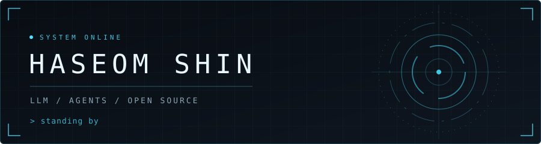

<p align="center">
  
</p>

```text
role      LLM / agent engineer
focus     LangGraph · document rendering · vector graphics
now       graph tooling in vectorcraft
status    standing by
```

### Open source

| Project | Work |
| --- | --- |
| [ooxml](https://github.com/ChristopherVR/ooxml/pulls?q=is%3Apr+is%3Amerged+author%3AIHAGI-c) · [pptx-viewer](https://github.com/ChristopherVR/pptx-viewer/pulls?q=is%3Apr+is%3Amerged+author%3AIHAGI-c) | Office viewer rendering. Korean line breaking, tables, charts. |
| [vectorcraft](https://github.com/storytold/vectorcraft/pulls?q=is%3Apr+is%3Amerged+author%3AIHAGI-c) · [designcraft](https://github.com/storytold/designcraft/pulls?q=is%3Apr+is%3Amerged+author%3AIHAGI-c) | Graph tooling, text layout. |
| [LangChain-OpenTutorial](https://github.com/LangChain-OpenTutorial/LangChain-OpenTutorial/pulls?q=is%3Apr+is%3Amerged+author%3AIHAGI-c) | Tutorials. |

### Built

- [langgraph-lecture](https://github.com/IHAGI-c/langgraph-lecture): LangGraph course material and a support-ticket agent with human approval.
- [langgraph-agent-tutorial](https://github.com/IHAGI-c/langgraph-agent-tutorial): Shopping-support chatbot on LangGraph V1.0.

### Contact

[LinkedIn](https://www.linkedin.com/in/ihagi)
